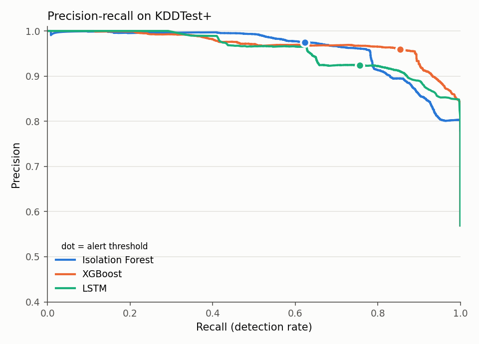
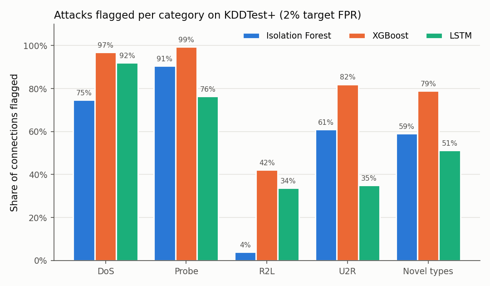
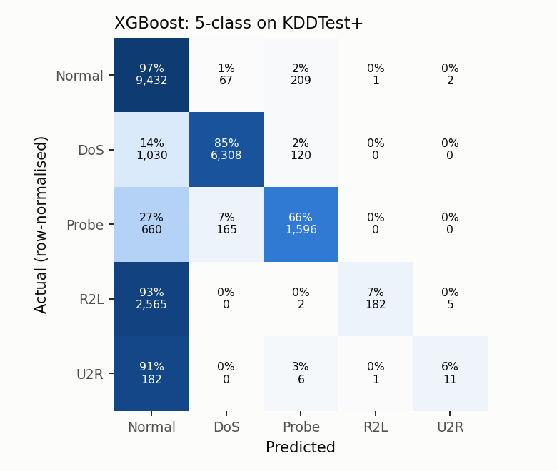

# Network Intrusion Detection (NSL-KDD)

Machine-learning intrusion detection on the NSL-KDD connection dataset,
comparing one **unsupervised** detector (Isolation Forest) against two
**supervised** ones (XGBoost and an LSTM) across the five NSL-KDD classes:
Normal, DoS, Probe, R2L and U2R.

The comparison is set up the way an alert pipeline would actually run: each
model gets one alert threshold, chosen on held-out training data for a 2%
false-positive budget, and is then scored on test traffic that includes 17
attack types it never saw in training.

---

## Problem

A detector is only useful if a SOC can afford to read its alerts. So the
question here isn't "which model has the best accuracy?" It's: **at a fixed
false-positive budget, which approach catches the most attacks, and does that
budget still hold when the traffic changes?**

The two approaches fail in different ways:

- **Supervised models** (XGBoost, LSTM) learn the attacks they were shown. They
  should be strong on known attack types and weaker on new ones.
- **Unsupervised anomaly detection** (Isolation Forest) learns only what normal
  traffic looks like and flags anything else. In principle it needs no attack
  labels and isn't tied to known attacks. In practice it only catches attacks
  that *look* unusual.

NSL-KDD fits this question well because its test set contains attack types
missing from training, so detecting unseen attacks can be measured directly.

## Dataset

**NSL-KDD**, Canadian Institute for Cybersecurity, University of New Brunswick
(Tavallaee et al., 2009). Free for research use with citation. Full citation,
file digests and the attack-to-category mapping are in
[`data/README.md`](data/README.md). **No data is committed**; `data/raw/` is
git-ignored and every downloaded file is checked against a SHA-256 digest.

| Split | Rows | Normal | DoS | Probe | R2L | U2R |
|---|---|---|---|---|---|---|
| Train (80% of KDDTrain+) | 100,778 | 53,874 | 36,741 | 9,325 | 796 | 42 |
| Validation (20% of KDDTrain+) | 25,195 | 13,469 | 9,186 | 2,331 | 199 | 10 |
| **KDDTest+** | 22,544 | 9,711 | 7,458 | 2,421 | 2,754 | 200 |
| KDDTest-21 (hard subset) | 11,850 | 2,152 | 4,342 | 2,402 | 2,754 | 200 |

Two things in that table drive most of the results:

1. **Class imbalance.** U2R is 0.04% of training rows (52 in all of KDDTrain+).
2. **Distribution shift.** R2L goes from 0.8% of training to 12% of KDDTest+,
   and 17 attack types appear only in the test sets (`mscan`, `apache2`,
   `snmpguess`, `processtable`, …). Rows from those types make up 3,750 of
   KDDTest+'s 12,833 attacks.

KDDTest-21 keeps only the KDDTest+ rows that 21 reference classifiers found
hard. Its normal traffic is just the 2,152 hardest normal rows, so its FPRs are
much higher and should not be read as typical.

## Approach

```
              ┌──────────────────┐
  mirrors  →  │ download_data.py │  data/raw/  (SHA-256 verified, git-ignored)
              └────────┬─────────┘
              ┌────────▼─────────┐
              │  preprocess.py   │  attack name → 5 categories
              └────────┬─────────┘  stratified 80/20 train/validation split
                       │            fitted on train only:
                       │              one-hot protocol / service / flag
                       │              log1p on heavy-tailed counts
                       │              StandardScaler; drop constant columns
                       │            → 121 features
              ┌────────▼─────────┐
              │    models.py     │  Isolation Forest  (normal rows only, no labels)
              └────────┬─────────┘  XGBoost           (5-class, early stopping)
                       │            LSTM, Keras        (5-class, early stopping)
              ┌────────▼─────────┐
              │   evaluate.py    │  threshold per model: flag ≤ 2% of
              └────────┬─────────┘  validation normal traffic
                       │            then score KDDTest+ and KDDTest-21
                       ▼
       outputs/metrics.json · outputs/results.md · outputs/*.png
```

**Preprocessing.** All transforms (one-hot vocabulary, log scaling,
standardisation, which columns to drop) are fitted on the training split only
and then applied unchanged to validation and test, so the test sets never
influence preprocessing. `num_outbound_cmds` is always zero and is dropped.
Services that appear only in the test sets encode as all zeros instead of
raising an error.

**Isolation Forest** (300 trees, 256 samples per tree) is trained on the
53,874 normal training rows only. It never sees an attack label. Even its
threshold needs only a sample of known-good traffic.

**XGBoost** is a 5-class gradient-boosted tree model. Its sample weights are
the square root of balanced class weights. Full balancing would give each U2R
row about 1,300× the weight of a normal row, which mostly teaches overfitting;
the square root brings that down to about 36×.
Early stopping on validation log-loss chose 163 trees.

**LSTM** is a two-layer Keras LSTM (64 → 32 units, dropout 0.3, softmax over
5 classes) with the same class weighting and early stopping on validation loss.
**It has no real sequence to model:** NSL-KDD rows are independent connection
summaries with no timestamps or ordering. Each row goes in as a one-step
sequence, so the LSTM acts as a gated feed-forward network. The
`lstm.timesteps` setting can slice the feature vector into chunks, but that is
an architecture choice, not a time axis. This is a limit of the dataset, and
it's the main reason an LSTM is not the right tool here (see
[Limitations](#limitations)).

**One alert threshold per model.** Each model gives every connection an
"attack score": the negated isolation score for Isolation Forest, and
`1 − P(normal)` for the supervised models. The threshold is set so that 2% of
**validation** normal traffic would be flagged. The test FPR is then measured,
not assumed. Each model's out-of-the-box decision (Isolation Forest's built-in
offset, argmax for the classifiers) is reported alongside.

## Results

Status: **the pipeline runs end to end on the real dataset.** Every number
below comes from `outputs/metrics.json`, produced by a local run on 2026-11-17
(Python 3.11.9, x86_64, CPU only). Two consecutive runs gave identical metrics;
only the timings differed. Re-running regenerates all of it.

### Attack vs normal on KDDTest+, threshold set for 2% FPR on validation

| Model | Detection rate | FPR on test | Precision | F1 | ROC-AUC | PR-AUC |
|---|---|---|---|---|---|---|
| Isolation Forest (unsupervised) | 62.3% | **2.1%** | **97.5%** | 0.760 | 0.949 | 0.961 |
| XGBoost | **85.4%** | 4.8% | 96.0% | **0.904** | **0.968** | **0.971** |
| LSTM | 75.7% | 8.2% | 92.4% | 0.832 | 0.950 | 0.956 |



### Share of each category flagged on KDDTest+ (same thresholds)

| Model | DoS | Probe | R2L | U2R | Novel attack types | Known attack types |
|---|---|---|---|---|---|---|
| Isolation Forest | 74.7% | 90.5% | 4.0% | 61.0% | 59.1% | 63.6% |
| XGBoost | 96.9% | 99.4% | 42.2% | 82.0% | 79.0% | 88.1% |
| LSTM | 92.0% | 76.3% | 33.8% | 35.0% | 51.3% | 85.7% |



### 5-class accuracy on KDDTest+ (supervised models)

| Model | Accuracy | Macro F1 | Normal | DoS | Probe | R2L | U2R |
|---|---|---|---|---|---|---|---|
| XGBoost | 77.8% | 0.532 | 97.1% | 84.6% | 65.9% | 6.6% | 5.5% |
| LSTM | 75.6% | 0.543 | 94.5% | 78.9% | 65.3% | 13.8% | 8.5% |

(The per-class columns are recall.)



Full tables, including KDDTest-21 and each model's default decision, are in
[`outputs/results.md`](outputs/results.md). Training time on a 4-core laptop
CPU: Isolation Forest 0.6 s, XGBoost 12 s, LSTM 85-90 s.

### What the numbers say

**1. The unsupervised model was the only one whose false-positive budget held.**
All three thresholds were set to flag 2% of validation normal traffic. On
KDDTest+, Isolation Forest flagged 2.1% of normal traffic, XGBoost 4.8% and the
LSTM 8.2%. Both supervised models were close to perfect on validation (ROC-AUC
1.000), so their thresholds sit in the extreme tail of `P(attack)` (0.0021 for
XGBoost, 0.0074 for the LSTM), where small changes in the traffic move a lot of
normal rows across the line. A model that only learned what normal looks like
was more stable there. In a SOC that difference matters: a budget that doubles
or quadruples on new traffic is a budget nobody can staff for.

**2. XGBoost caught the most attacks, including unseen ones.** At its threshold
it flagged 85.4% of attacks and 79.0% of attacks from types it never trained on.
Isolation Forest flagged 59.1% of the unseen types. The idea that unsupervised
detection wins on new attacks **did not hold on this data**. Many test-only
attacks (`mscan`, `apache2`, `processtable`) look like the DoS and Probe
traffic XGBoost already knows, so its "Normal vs not Normal" boundary carries
over. Note the precision: the detection rate was bought with more than twice
Isolation Forest's false-positive rate.

**3. Isolation Forest is nearly blind to R2L (4.0%).** R2L attacks
(`guess_passwd`, `warezmaster`, `snmpguess`, …) arrive as ordinary-looking
single connections to normal services. In this feature space they are not
outliers, so an outlier detector will not see them. DoS and Probe are the
opposite case: floods and scans are statistically loud, and Isolation Forest
finds 75-91% of them with no labels at all.

**4. Detecting an attack and naming it are different problems.** In 5-class
mode XGBoost labelled only 6.6% of R2L and 5.5% of U2R correctly, and 93% of R2L
was predicted as Normal. As a binary detector at a tuned threshold it still
flagged 42% of R2L and 82% of U2R, because a small but non-zero `P(attack)` is
signal that argmax throws away. For triage, a calibrated "this is suspicious"
score is more useful than a confident wrong class label.

**5. The LSTM added cost without adding accuracy.** It trained 7× slower than
XGBoost, detected fewer attacks and had the highest test FPR. Its one edge is
slightly better rare-class recall in 5-class mode (R2L 13.8% vs 6.6%), giving
the best macro F1 (0.543 vs 0.532), but the gap is small. That is expected
given the point above: with no sequence to learn from, its recurrent structure
has nothing to use.

**6. The validation-to-test gap is the main finding, not a bug.** On
validation (same distribution as training) the supervised models scored
ROC-AUC 1.000 and detected 99.99% of attacks at 2% FPR. On KDDTest+ that
dropped to 0.968 and 85.4%. Validation scores on NSL-KDD measure memorisation.
Only the test sets measure generalisation, and that is the gap a production
detector faces every time the traffic drifts.

## How to run

```bash
python3 -m venv .venv && source .venv/bin/activate
```

```bash
pip install -r requirements.txt
```

On macOS, XGBoost also needs the OpenMP runtime. Use `brew install libomp`, or,
where Homebrew can't provide it, the helper below. It reuses the `libomp` that
scikit-learn already bundles, and only touches files in `.venv`:

```bash
scripts/fix_macos_libomp.sh
```

Then run the pipeline:

```bash
python -m src.run_pipeline
```

That downloads NSL-KDD (~24 MB, digest-verified), trains all three models,
evaluates them on both test sets, and writes `outputs/metrics.json`,
`outputs/results.md`, the figures, and the trained models (`outputs/models/`,
git-ignored). It takes about 2 minutes on a laptop CPU. All settings
(thresholds, model hyperparameters, class weighting, validation fraction) are
in [`config.yaml`](config.yaml).

To run the tests (synthetic data, no download needed):

```bash
python -m pytest -q
```

## Limitations

- **NSL-KDD is old and synthetic.** It comes from the 1998 DARPA evaluation:
  simulated traffic, 1990s attacks, connection-level features computed by a
  tool that no longer reflects modern networks. These results show how the
  three approaches compare on this benchmark. They do not predict performance
  on real traffic, and 85% detection here means nothing for a production
  network. Datasets like CIC-IDS2017 or UNSW-NB15 are the next step.
- **No temporal structure, so the LSTM comparison is weak.** Because rows are
  independent, the LSTM couldn't use the one thing it's designed for. A fair
  test of a sequence model needs flow sequences or time-ordered packets.
- **The LSTM may be slightly undertrained.** Early stopping never fired: the
  best validation loss came at epoch 37 of the 40 allowed. More epochs might
  narrow the gap a little, but not the FPR drift, which comes from the
  near-perfect validation fit.
- **One fixed operating point.** The 2% target FPR is a single choice. The PR
  curves show the whole trade-off, and the ranking changes along it: up to
  about 65% recall, Isolation Forest has the highest precision of the three;
  above about 70%, XGBoost does.
- **Single split, single seed.** The numbers are deterministic for this seed
  and split. No confidence intervals were computed, so small differences
  (the LSTM's 0.543 vs XGBoost's 0.532 macro F1, for example) shouldn't be
  over-read.
- **Little hyperparameter tuning.** Settings are reasonable defaults with early
  stopping, not a search. A tuned model would likely score somewhat higher; it
  would not change the distribution-shift picture.
- **Category labels for two attacks are a convention.** `worm` and `httptunnel`
  are categorised inconsistently across the literature (see `data/README.md`).
  That affects 135 KDDTest+ rows.

## Repository layout

```
config.yaml                 every tunable setting
src/download_data.py        fetch + SHA-256 verify NSL-KDD
src/preprocess.py           category mapping, train-only encoding/scaling
src/models.py               Isolation Forest, XGBoost, LSTM behind one interface
src/evaluate.py             threshold calibration and metrics
src/plots.py                README figures
src/run_pipeline.py         end-to-end run
tests/                      unit tests on synthetic data
scripts/fix_macos_libomp.sh macOS OpenMP workaround for XGBoost
outputs/                    metrics.json, results.md, figures (models git-ignored)
```

## Licence

Code: MIT (see [`LICENSE`](LICENSE)). Dataset: NSL-KDD, Canadian Institute for
Cybersecurity, University of New Brunswick, used under its research terms;
not redistributed here.
